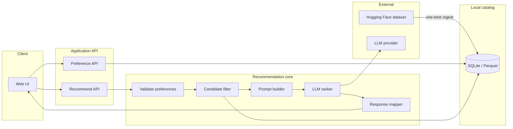
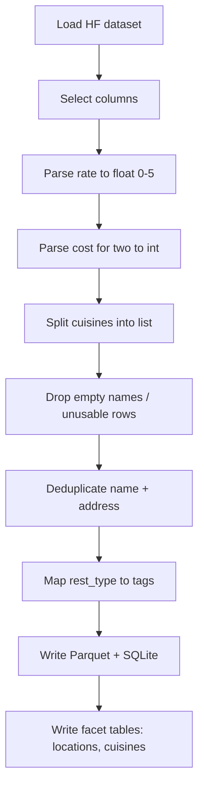
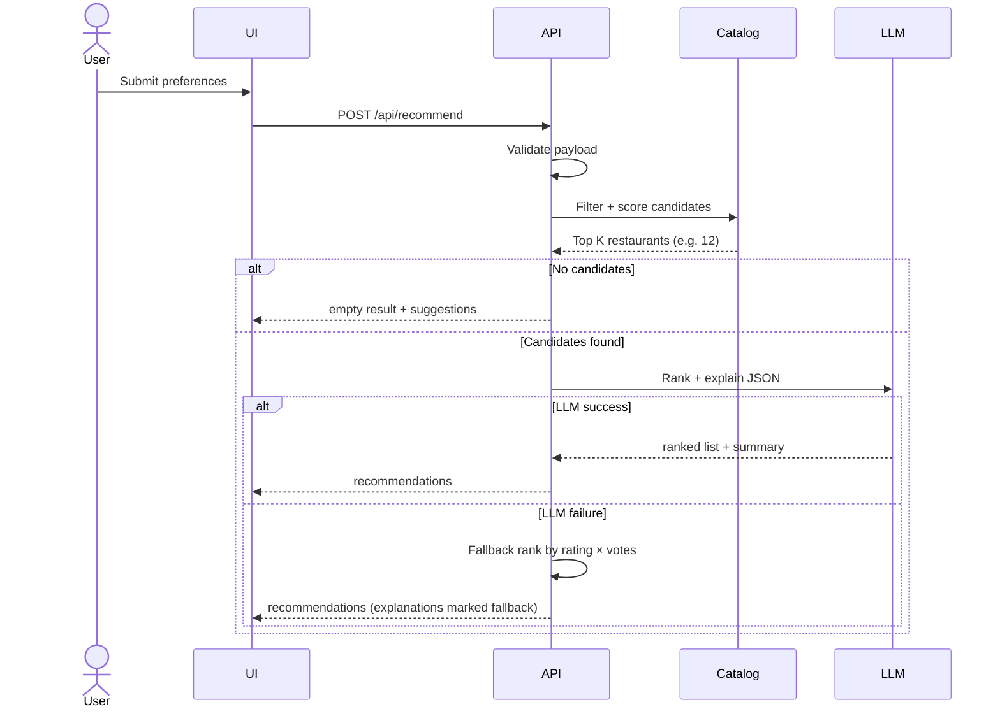
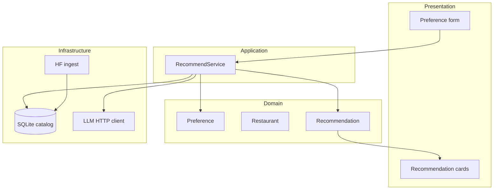

# DineMate Architecture

This document describes how to build **DineMate**, an AI-powered restaurant recommendation service. It maps the workflow in [`problemStatement.md`](./problemStatement.md) onto a concrete system: data pipeline, APIs, LLM ranking, and UI.

The design principle is **filter first, then reason**. The catalog is large (~51k Zomato rows). Hard constraints (location, budget, cuisine, rating) are applied in code. Only a small candidate set is sent to the LLM, which ranks venues and writes human-like explanations.

---

## 1. Goals and non-goals

### Goals

- Load real restaurant records from [ManikaSaini/zomato-restaurant-recommendation](https://huggingface.co/datasets/ManikaSaini/zomato-restaurant-recommendation)
- Collect structured user preferences and use them to narrow candidates
- Rank a shortlist with an LLM and explain why each pick fits
- Show scannable results: name, cuisine, rating, estimated cost, AI explanation
- Stay cheap and fast: small prompts, cached catalog, deterministic filters

### Non-goals (v1)

- Live Zomato booking, payments, or maps
- User accounts, saved lists, or collaborative filtering
- Fine-tuning a custom model
- City coverage beyond what the dataset actually contains (this snapshot is Bangalore-centric)

---

## 2. High-level architecture



DineMate is a **web app + Python API**. The UI never talks to Hugging Face or the LLM directly. The API owns catalog queries, prompt construction, and structured LLM output.

---

## 3. Mapping to the problem-statement workflow

| Problem-statement step | Architecture component | Responsibility |
| --- | --- | --- |
| Data ingestion | Ingest job + restaurant catalog | Download, clean, normalize, persist |
| User input | Preference form + `/api/preferences/options` | Collect location, budget, cuisine, rating, extras |
| Integration layer | Candidate filter + prompt builder | Apply hard filters; pack a shortlist into a prompt |
| Recommendation engine | LLM ranker | Rank, explain, optional summary |
| Output display | Results view | Cards with name, cuisine, rating, cost, explanation |

---

## 4. Recommended stack

Chosen for a student project that still looks like a real service.

| Layer | Choice | Why |
| --- | --- | --- |
| Frontend | React + Vite (TypeScript) | Fast form + results UI; easy to iterate |
| Backend | FastAPI (Python) | Native pandas/Hugging Face; simple JSON APIs |
| Catalog | SQLite (primary) + Parquet snapshot | Queryable, portable, no extra infra |
| Ingest | `datasets` + pandas | Official Hugging Face loader |
| LLM | Any OpenAI-compatible chat API (Groq, OpenAI, Gemini via adapter) | Swap models with env vars |
| Structured output | JSON schema / tool-style response | Reliable ranking objects, not free-form prose |
| Config | `.env` | API keys stay out of source |

Streamlit is an acceptable fallback if the goal is a single-file prototype. The architecture below assumes FastAPI + React so the UI and engine stay separable.

---

## 5. Repository layout

```text
ai-restaurant-dinemate/
  docs/
    problemStatement.md
    architecture.md
  data/
    raw/                          # optional local cache of HF files
    processed/
      restaurants.parquet
      restaurants.sqlite
  backend/
    app/
      main.py                     # FastAPI app
      api/
        routes_recommend.py
        routes_meta.py
      domain/
        models.py                 # Preference, Restaurant, Recommendation
        budget.py                 # low / medium / high bands
      catalog/
        ingest.py
        store.py                  # SQLite access
        filters.py
      llm/
        client.py
        prompts.py
        schemas.py                # expected LLM JSON
      services/
        recommend.py              # orchestrates filter → LLM → map
    tests/
    pyproject.toml / requirements.txt
  frontend/
    src/
      pages/RecommendPage.tsx
      components/PreferenceForm.tsx
      components/RecommendationCard.tsx
      api/client.ts
  .env.example
```

---

## 6. Data architecture

### 6.1 Source dataset (as published)

The Hugging Face dataset has **51,717 rows** and these fields:

| Source column | Use in DineMate |
| --- | --- |
| `name` | Display + identity |
| `address` | Display + duplicate key |
| `location` | Neighborhood filter (~93 values, e.g. Banashankari) |
| `listed_in(city)` | Broader Bangalore listing area (~30 values) |
| `cuisines` | Cuisine filter (comma-separated) |
| `approx_cost(for two people)` | Budget bands |
| `rate` | Minimum rating (`"4.1/5"`, `"NEW"`, `"-"`) |
| `votes` | Tie-break / confidence |
| `rest_type` | Extra prefs: Quick Bites, Casual Dining, Cafe, … |
| `listed_in(type)` | Buffet, Cafes, Delivery, Desserts, Dine-out, Drinks & nightlife, Pubs and bars |
| `online_order`, `book_table` | Optional extras |
| `dish_liked` | Soft match for additional preferences |
| `reviews_list` | Short snippets for the LLM (truncated) |
| `url` | Optional “open on Zomato” link |
| `phone`, `menu_item` | Not required for v1 ranking |

**Dataset constraint:** listings are Bangalore restaurants, not a multi-city India catalog. The problem statement uses “Delhi, Bangalore” as *examples of preference shape*. The UI should offer **actual `location` / `listed_in(city)` values** from the catalog, not invented cities.

### 6.2 Ingestion pipeline

Run once at setup (and again if the dataset is refreshed).



**Cleaning rules**

1. **Rating.** Parse `"4.1/5"` → `4.1`. Treat `"NEW"`, `"-"`, missing as `null`. Those rows fail a minimum-rating filter unless the user leaves rating empty.
2. **Cost.** `"800"` or `"1,200"` → integer. Missing cost: keep the row but exclude it from budget filters (or assign `unknown`).
3. **Cuisines.** Split on comma; trim; store both `cuisines_raw` and a normalized list.
4. **Dedup.** The same restaurant appears under multiple `listed_in(type)` / `listed_in(city)` rows. Keep one row per `(normalized name, address)`, merging types into a list.
5. **Reviews.** Do not store the full 1MB-scale `reviews_list` in the LLM path. Persist at most 2–3 short snippets (capped characters) or skip reviews and use `dish_liked` only.
6. **PII.** Phone numbers are not needed for recommendations; omit them from the served catalog.

### 6.3 Canonical restaurant record

```text
Restaurant
  id                  hash(name + address)
  name
  address
  neighborhood        location
  listed_city         listed_in(city)
  cuisines            string[]
  cost_for_two        int | null
  rating              float | null
  votes               int
  rest_types          string[]
  listed_types        string[]
  online_order        bool
  book_table          bool
  dishes_liked        string[]
  review_snippets     string[]     # truncated
  url                 string | null
```

SQLite indexes: `neighborhood`, `listed_city`, `rating`, `cost_for_two`. Cuisine matching can use a junction table `restaurant_cuisine(restaurant_id, cuisine)` or `LIKE` on a normalized string for v1.

---

## 7. Preference model

### 7.1 User input (problem statement)

| Field | Type | Filter behavior |
| --- | --- | --- |
| Location | neighborhood or listed city | Hard filter (case-insensitive exact / alias) |
| Budget | `low` \| `medium` \| `high` | Hard filter on `cost_for_two` |
| Cuisine | string | Hard filter: cuisine list contains value |
| Minimum rating | number (e.g. 3.5, 4.0) | Hard filter: `rating >= min` |
| Additional preferences | free text or tags | **Soft**: used in LLM prompt; optional keyword boost |

### 7.2 Budget bands

The dataset cost is **approximate cost for two** in INR. Suggested default bands (tunable in config):

| Budget | Cost for two |
| --- | --- |
| Low | ≤ 400 |
| Medium | 401–800 |
| High | ≥ 801 |

Document these thresholds in the UI so “medium” is not a mystery.

### 7.3 Extra preferences

Map common tags onto structured fields before falling back to the LLM:

| User intent | Catalog signal |
| --- | --- |
| Quick service | `rest_type` contains `Quick Bites` |
| Family-friendly | `Casual Dining`, `Buffet`; avoid `Pubs and bars` / `Drinks & nightlife` unless asked |
| Cafe / dessert | `listed_in(type)` or cuisine |
| Table booking | `book_table = Yes` |
| Online order | `online_order = Yes` |

Unmapped free text (“quiet rooftop”, “great pasta”) is passed to the LLM with `dish_liked` and snippets so it can prefer matching candidates.

### 7.4 Facet API

`GET /api/meta/options` returns distinct locations, cuisines, and rating/budget enums from the catalog. The form should be driven by this endpoint so users cannot pick a location the dataset does not have.

---

## 8. Recommendation flow



### 8.1 Validate

Reject unknown budget values, negative ratings, empty location if required. Normalize cuisine casing.

### 8.2 Candidate filter (integration layer)

Apply in this order:

1. Location: `neighborhood = X` OR `listed_city = X` (configurable)
2. Budget band on `cost_for_two`
3. Cuisine containment
4. `rating >= min_rating` (skip rows with null rating)
5. Optional structured extra tags (`book_table`, `rest_type`, …)

If the result set is empty, **relax in a defined order** (e.g. drop extra tags, then widen budget by one band) and tell the UI what was relaxed. Do not silently change the user’s request.

Cap the shortlist at **K = 8–15**. If more remain, pre-rank by:

```text
score = rating (missing → 0) * log(1 + votes)
```

Optionally add a small boost when extra-preference keywords appear in `dishes_liked`.

**Never send the full catalog to the LLM.** That is the main cost and quality control.

### 8.3 Prompt builder

Each candidate in the prompt is a compact JSON object, not a dump of reviews:

```json
{
  "id": "abc123",
  "name": "Jalsa",
  "neighborhood": "Banashankari",
  "cuisines": ["North Indian", "Mughlai", "Chinese"],
  "rating": 4.1,
  "votes": 775,
  "cost_for_two": 800,
  "rest_types": ["Casual Dining"],
  "dishes_liked": ["Pasta", "Lunch Buffet", "Dum Biryani"],
  "notes": "Buffet, table booking available"
}
```

Prompt contract:

- Role: local dining concierge for Bangalore (dataset geography)
- Inputs: user preference block + candidate array
- Rules:
  - Rank **only** from the provided IDs
  - Do not invent restaurants, ratings, or prices
  - Prefer candidates that match extra preferences
  - Return JSON matching the schema
  - Explanations: 1–2 sentences, specific to this user’s constraints

### 8.4 LLM ranker

Request **structured JSON**, for example:

```json
{
  "summary": "Best matches for North Indian under a medium budget in Banashankari.",
  "recommendations": [
    {
      "id": "abc123",
      "rank": 1,
      "explanation": "North Indian and Mughlai at ₹800 for two with a 4.1 rating and buffet options, which fits a family meal."
    }
  ]
}
```

Return **top N = 5** (fewer if K is smaller). Drop any ID the model hallucinates. Re-attach catalog fields (name, cuisine, rating, cost) **from the database**, not from the model.

### 8.5 Fallback

If the LLM times out, returns invalid JSON, or is unconfigured:

- Sort candidates by the same pre-rank score
- Generate a template explanation:  
  `"{name} matches {cuisine} in {location} with rating {rating} and ~₹{cost} for two."`
- Set `source: "heuristic"` so the UI can be honest

### 8.6 Response to the UI

```json
{
  "query": { "location": "Banashankari", "budget": "medium", "cuisine": "North Indian", "min_rating": 4.0 },
  "candidate_count": 12,
  "relaxed_filters": [],
  "summary": "...",
  "source": "llm",
  "recommendations": [
    {
      "rank": 1,
      "name": "Jalsa",
      "cuisines": ["North Indian", "Mughlai", "Chinese"],
      "rating": 4.1,
      "estimated_cost": 800,
      "neighborhood": "Banashankari",
      "explanation": "...",
      "url": "https://www.zomato.com/..."
    }
  ]
}
```

This matches the required display fields: **name, cuisine, rating, estimated cost, AI-generated explanation**.

---

## 9. API surface

| Method | Path | Purpose |
| --- | --- | --- |
| `GET` | `/health` | Liveness |
| `GET` | `/api/meta/options` | Locations, cuisines, budget labels |
| `POST` | `/api/recommend` | Filter + LLM recommendations |
| `POST` | `/api/ingest` | Optional admin: rebuild catalog (local/dev only) |

**`POST /api/recommend` body**

```json
{
  "location": "Banashankari",
  "budget": "medium",
  "cuisine": "Italian",
  "min_rating": 4.0,
  "extras": "family-friendly, quick service"
}
```

Keep the API stateless. No session store is required for v1.

---

## 10. Frontend architecture

Two screens are enough.

1. **Preference form**  
   Location (select from catalog), budget (low/medium/high with cost hint), cuisine (select or typeahead), minimum rating, extras text. Submit calls `/api/recommend`.

2. **Results**  
   Optional one-line `summary`, then ranked cards:
   - Rank badge
   - Restaurant name
   - Cuisine chips
   - Rating + votes
   - Estimated cost for two
   - Explanation paragraph
   - Empty state: “No matches; try widening budget or dropping cuisine”

Loading and error states: spinner while the LLM runs; toast if the engine fell back to heuristic ranking.

The UI must not call the LLM provider. That keeps keys on the server.

---

## 11. LLM integration details

```text
backend/app/llm/
  client.py      # chat.completions wrapper, timeout, retries
  prompts.py     # system + user templates
  schemas.py     # Pydantic models for LLM JSON
```

**Provider adapter:** one interface `complete_json(system, user) -> dict`. Implementation uses `OPENAI_API_KEY` + `OPENAI_BASE_URL` + `MODEL_NAME` so Groq, OpenAI, or a local model can be swapped.

**Guardrails**

- Timeout ~20s; one retry on 5xx
- Max output tokens sized for 5 short explanations
- Temperature low (0.2–0.4) for stable ranking
- Validate JSON with Pydantic; on failure, fallback
- Truncate candidate payload to a token budget (~3–4k tokens)

**What the model is not allowed to do**

- Invent restaurants outside the candidate list
- Change rating or cost
- Claim live availability, wait times, or “open now”

---

## 12. Component responsibilities



| Component | Owns | Must not own |
| --- | --- | --- |
| UI | Forms, display, empty/error states | SQL, prompts, API keys |
| RecommendService | Orchestration, relaxation policy | Raw HTTP to Hugging Face |
| filters.py | Deterministic matching | Natural-language generation |
| prompts.py | Template + candidate packing | Database access |
| llm/client.py | Transport, retries, parsing | Business ranking rules |
| catalog/store.py | Queries | Prompt text |

---

## 13. Cross-cutting concerns

### Performance

- Ingest once; serve from SQLite
- Keep K small
- Optional: cache `hash(preferences) → response` in memory for a few minutes during demos

### Reliability

- Heuristic fallback if the LLM is down
- Health check does not call the LLM
- Log filter counts: `matched_after_location`, `after_budget`, `after_cuisine`, `sent_to_llm`

### Security

- LLM API key only in server env
- Do not expose `/api/ingest` in production without auth
- Do not send full `reviews_list` (size + possible personal data in free text)

### Observability

Log request id, preference payload, candidate ids, `source` (`llm` | `heuristic`), latency of filter vs LLM.

### Cost control

One recommendation request ≈ one LLM call on ~12 short records. That is the intended cost model.

---

## 14. Configuration

`.env.example`:

```text
CATALOG_DB_PATH=data/processed/restaurants.sqlite
HF_DATASET=ManikaSaini/zomato-restaurant-recommendation
LLM_BASE_URL=
LLM_API_KEY=
LLM_MODEL=
CANDIDATE_LIMIT=12
RESULT_LIMIT=5
BUDGET_LOW_MAX=400
BUDGET_MEDIUM_MAX=800
```

---

## 15. Build sequence

Implement in this order so each step is demoable:

1. **Ingest** — script writes SQLite; sanity-check row counts and distinct locations
2. **Catalog queries** — unit tests for budget, cuisine, rating, location
3. **RecommendService without LLM** — return top 5 heuristic results
4. **LLM adapter** — structured rank + explanations on the same shortlist
5. **FastAPI routes**
6. **React form + cards**
7. **Empty / relaxed-filter / LLM-down states**
8. **Polish** — cost labels, summary line, Zomato URL

---

## 16. Testing strategy

| Layer | What to test |
| --- | --- |
| Ingest | Rating/cost parsers; dedup; null handling |
| Filters | Each constraint in isolation; combination; empty set |
| Budget map | Boundaries 400 / 401 / 800 / 801 |
| Prompt | Candidate JSON contains only allowlisted fields |
| LLM mapper | Drops unknown ids; preserves catalog rating/cost |
| Fallback | Invalid JSON → heuristic, `source=heuristic` |
| API | 422 on bad body; 200 empty list; 200 with 5 cards |
| UI | Form validation; loading; empty state |

Use a **fixture catalog** of 20–30 restaurants for tests instead of the full 51k rows.

---

## 17. Risks and decisions

| Risk | Mitigation |
| --- | --- |
| Dataset is Bangalore-only while the brief says “e.g. Delhi” | Drive location from catalog facets; note geography in the UI |
| Duplicate listings inflate results | Dedup on name + address at ingest |
| LLM invents venues | ID allowlist; rehydrate from SQLite |
| Messy `rate` / cost strings | Parse at ingest; store numeric columns |
| Huge `reviews_list` blows tokens | Truncate or omit; prefer `dish_liked` |
| Over-filtering → zero results | Explicit relaxation + user-visible message |
| LLM outage during a demo | Heuristic ranking always available |

---

## 18. Success criteria (architecture view)

The system satisfies [`problemStatement.md`](./problemStatement.md) when:

1. The running app reads **processed records from the Hugging Face Zomato dataset**, not mocked names
2. User preferences **change the candidate set** in code before any LLM call
3. The LLM (or documented fallback) returns a **ranked list with per-item explanations**
4. The UI shows **name, cuisine, rating, estimated cost, and explanation** in a scannable layout

That is the architecture to implement: a local restaurant catalog, a strict filter layer, a small honest LLM ranker, and a simple results UI.
