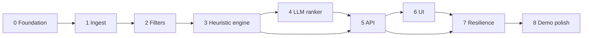

# DineMate Implementation Plan

Phase-wise plan for building DineMate from [`problemStatement.md`](./problemStatement.md) and [`architecture.md`](./architecture.md).

**Rule for every phase:** ship something you can run or test before starting the next phase. Do not jump to the LLM or UI while ingest and filters are unfinished.

**Design principle:** filter first, then reason. Hard constraints run in code. The LLM only ranks a shortlist and writes explanations.

---

## Overview

| Phase | Name | Problem-statement step | Outcome |
| --- | --- | --- | --- |
| 0 | Foundation | — | Repo, stack, config, empty apps |
| 1 | Data ingestion | 1. Data ingestion | Clean SQLite/Parquet catalog from Hugging Face |
| 2 | Catalog and filters | 3. Integration layer (filter) | Deterministic candidate shortlist |
| 3 | Heuristic engine | 4. Ranking fallback | Top-N results without an LLM |
| 4 | LLM ranker | 3–4. Prompt + recommendation engine | Ranked list with explanations |
| 5 | HTTP API | 2–4. Integration | FastAPI endpoints the UI can call |
| 6 | Web UI | 2. User input, 5. Output display | Preference form and result cards |
| 7 | Resilience and empty states | Reliability | Relaxed filters, fallback, honest errors |
| 8 | Polish, tests, demo | Success criteria | Assignment-ready DineMate |

Suggested order is strict through Phase 5. Phases 6 and 7 can overlap slightly once the API is stable. Phase 8 is last.

---

## Phase 0 — Foundation

**Goal.** Create the project skeleton so later work has a home.

**Depends on.** Nothing.

### Tasks

1. Create the layout from architecture §5:
   - `backend/`, `frontend/`, `data/raw/`, `data/processed/`, `docs/`
2. Backend: FastAPI app with `GET /health` returning `{ "status": "ok" }`.
3. Frontend: Vite + React + TypeScript app that renders a placeholder page.
4. Add `backend` dependencies: FastAPI, uvicorn, pandas, datasets, pydantic, python-dotenv, httpx (or OpenAI SDK), pytest.
5. Add `frontend` dependencies: React, Vite.
6. Add `.env.example` with the keys from architecture §14. Add `.env` to `.gitignore`.
7. Add `data/processed/` to `.gitignore` if generated files are large; keep a note in README on how to rebuild.
8. Short README: how to create a venv, install, run ingest (placeholder), run API, run UI.

### Deliverables

- Runnable API health check
- Runnable frontend placeholder
- `.env.example`

### Exit criteria

- `uvicorn` serves `/health`
- `npm run dev` opens the Vite app
- No API keys committed

---

## Phase 1 — Data ingestion

**Goal.** Load the real Zomato dataset, clean it, persist a catalog. Maps to problem-statement workflow step 1.

**Depends on.** Phase 0.

### Tasks

1. Implement `backend/app/catalog/ingest.py`:
   - Load `ManikaSaini/zomato-restaurant-recommendation`
   - Keep columns listed in architecture §6.1
   - Drop `phone` and full `menu_item`
2. Parsers (unit-test these first with sample strings):
   - `rate`: `"4.1/5"` → `4.1`; `"NEW"`, `"-"`, missing → `null`
   - `approx_cost(for two people)`: `"800"`, `"1,200"` → int; missing → `null`
   - `cuisines`: split on comma, trim
   - `votes`: coerce to int
   - `online_order` / `book_table`: yes/no → bool
3. Deduplicate on normalized `(name, address)`. Merge `rest_type` and `listed_in(type)` into lists.
4. Truncate reviews: at most 2–3 short snippets, or skip and keep `dish_liked` only.
5. Assign `id = hash(name + address)`.
6. Write `data/processed/restaurants.parquet` and `data/processed/restaurants.sqlite`.
7. Create indexes: `neighborhood`, `listed_city`, `rating`, `cost_for_two`.
8. Optional cuisine junction table, or a searchable cuisine string for v1.
9. CLI: `python -m app.catalog.ingest` (from `backend/`).
10. Print a ingest summary: row count in, row count out, distinct neighborhoods, distinct cuisines.

### Tests

- Rating and cost parsers (including commas and junk)
- Dedup collapses duplicate listings
- Empty name rows dropped
- Fixture of ~10 raw-like rows produces expected SQLite rows

### Exit criteria

- Ingest runs end-to-end against Hugging Face (or a cached local copy)
- SQLite contains real restaurant names (for example Jalsa), numeric ratings and costs
- Distinct locations are Bangalore neighborhoods, not a fake city list
- Phone numbers are not in the served tables

**Demo checkpoint.** Open the SQLite file and query 5 rows by neighborhood.

---

## Phase 2 — Catalog store and candidate filters

**Goal.** Turn user preferences into a shortlist in code. This is the integration-layer filter from the problem statement and architecture §8.2.

**Depends on.** Phase 1.

### Tasks

1. Domain models in `backend/app/domain/models.py`: `Preference`, `Restaurant`.
2. Budget helper in `domain/budget.py`:
   - low ≤ 400, medium 401–800, high ≥ 801 (config-driven)
3. `catalog/store.py`: load restaurants; query by filters; list facet values (locations, cuisines).
4. `catalog/filters.py` apply in order:
   1. Location: `neighborhood` OR `listed_city`
   2. Budget band
   3. Cuisine containment (case-insensitive)
   4. `rating >= min_rating` (exclude null ratings when min is set)
   5. Optional structured extras (`Quick Bites`, `book_table`, family-friendly tags)
5. Pre-rank: `score = rating_or_0 * log(1 + votes)`. Optional keyword boost from `dishes_liked`.
6. Cap at `CANDIDATE_LIMIT` (default 12).
7. Build a **fixture catalog** of 20–30 restaurants covering all budget bands, missing ratings, mixed cuisines. Use this in tests, not the full 51k rows.

### Tests

- Each filter in isolation
- Combined filters
- Empty result set
- Budget boundaries 400 / 401 / 800 / 801
- Candidate cap is 12 even if hundreds match
- Location matches neighborhood or listed city

### Exit criteria

- Given `{ location: Banashankari, budget: medium, cuisine: Italian, min_rating: 4.0 }`, the function returns ≤ 12 real candidates that all satisfy the hard constraints
- Facet lists come from the catalog, not hardcoded cities

**Demo checkpoint.** Python REPL or a small script prints a shortlist. No LLM yet.

---

## Phase 3 — Heuristic recommendation engine

**Goal.** Produce the same response shape the UI will need, using deterministic ranking. Unblocks API and UI work if the LLM is not ready.

**Depends on.** Phase 2.

### Tasks

1. `services/recommend.py` (LLM path stubbed):
   - Validate preferences (unknown budget, negative rating → error)
   - Filter → pre-rank → take top `RESULT_LIMIT` (default 5)
   - Template explanation:  
     `"{name} matches {cuisine} in {location} with rating {rating} and ~₹{cost} for two."`
   - Set `source: "heuristic"`
2. Response model matching architecture §8.6: query echo, `candidate_count`, `relaxed_filters` (empty for now), `summary` (simple sentence), `recommendations[]`.
3. Rehydrate display fields from the catalog only (name, cuisines, rating, `estimated_cost`, neighborhood, url).

### Tests

- Validation errors
- Top 5 ordering by score
- Response includes name, cuisine, rating, cost, explanation
- Empty filters → empty `recommendations` without crashing

### Exit criteria

- One function call with preferences returns JSON-shaped results scannable like the problem-statement output
- Works with the fixture DB and with the full catalog

**Demo checkpoint.** `python -m` script prints 5 restaurants for a sample query.

---

## Phase 4 — LLM ranker

**Goal.** Rank the shortlist and write human-like explanations. Maps to problem-statement steps 3–4.

**Depends on.** Phase 3. Never send the full catalog.

### Tasks

1. Pydantic schemas for LLM JSON (`llm/schemas.py`): `summary` + `recommendations[{ id, rank, explanation }]`.
2. `llm/prompts.py`:
   - System: Bangalore dining concierge; rank only provided IDs; do not invent names, ratings, or prices
   - User: preference block + compact candidate objects (architecture §8.3)
   - Token budget: truncate `dishes_liked` / snippets
3. `llm/client.py`:
   - `complete_json(system, user) -> dict`
   - Env: `LLM_BASE_URL`, `LLM_API_KEY`, `LLM_MODEL`
   - Timeout ~20s, one retry on 5xx, temperature 0.2–0.4
4. Mapper:
   - Drop unknown IDs
   - Sort by returned rank
   - Attach catalog fields; **ignore** any model-supplied rating/cost
   - Take top N
5. Wire into `RecommendService`:
   - If key missing, invalid JSON, or timeout → keep Phase 3 fallback, `source: "heuristic"`
   - Else `source: "llm"`
6. Do not claim live wait times or “open now” in the prompt.

### Tests

- Prompt packing includes only allowlisted fields
- Mapper drops hallucinated IDs
- Mapper keeps catalog rating/cost even if the model changes them
- Invalid JSON → heuristic path
- Missing API key → heuristic path (no crash)

### Exit criteria

- With a real key, a Banashankari / medium / North Indian query returns 5 cards with specific 1–2 sentence explanations
- Without a key, heuristic results still return
- One request ≈ one LLM call on ~12 candidates

**Demo checkpoint.** Call `RecommendService` from a script; print `source` and explanations.

---

## Phase 5 — HTTP API

**Goal.** Expose catalog facets and recommendations over HTTP. The UI must never call Hugging Face or the LLM.

**Depends on.** Phase 4 (can start against Phase 3 if the LLM is delayed).

### Tasks

1. `GET /health` — liveness only; do not call the LLM.
2. `GET /api/meta/options` — locations, cuisines, budget labels with INR hints, rating choices.
3. `POST /api/recommend` — body from architecture §9; 422 on invalid payload; 200 with empty list when nothing matches.
4. CORS for the Vite origin.
5. Optional `POST /api/ingest` **dev-only**, behind a flag; not for production.
6. Request logging: request id, filters, candidate count, `source`, filter vs LLM latency.
7. Load catalog path from `CATALOG_DB_PATH`. Fail clearly if the DB is missing (“run ingest first”).

### Tests

- 422 on bad budget
- 200 empty recommendations
- 200 with up to 5 items and required fields
- `/health` does not require `LLM_API_KEY`

### Exit criteria

- `curl` (or REST client) can fetch options and post preferences
- Response fields match what the UI will render

**Demo checkpoint.** Two curl commands: options + recommend.

---

## Phase 6 — Web UI

**Goal.** Collect preferences and show scannable results. Maps to problem-statement steps 2 and 5.

**Depends on.** Phase 5.

### Tasks

1. API client `frontend/src/api/client.ts` for `/api/meta/options` and `/api/recommend`.
2. `PreferenceForm`:
   - Location: select from catalog options (not free-typed Delhi unless it exists)
   - Budget: low / medium / high with cost-for-two hint
   - Cuisine: select or typeahead from catalog
   - Minimum rating
   - Additional preferences text (family-friendly, quick service)
   - Note that listings are Bangalore-based
3. Submit → `POST /api/recommend`; loading spinner while waiting.
4. `RecommendationCard` for each item:
   - Rank
   - Name
   - Cuisine chips
   - Rating (and votes if present)
   - Estimated cost for two
   - AI explanation
   - Optional Zomato URL
5. Optional summary line above the list.
6. Empty state: no matches; suggest widening budget or dropping cuisine.
7. Keys stay on the server; the browser does not call the LLM.

### Exit criteria

- [x] A diner can fill the form and see top recommendations with name, cuisine, rating, cost, and explanation
- [x] Location dropdown is populated from `/api/meta/options` (93 Bangalore neighborhoods)
- [x] Loading and empty states work
- [x] Enhanced UI/UX specifications implemented: Dine❤️Mate branding with animated red heart, warm food mood board palette (cream, dark olive, basil green, warm orange), playful welcome modal on load with 3D food illustration and floating badges, left sidebar food delivery dashboard, interactive category chips, and hover floating micro-animations.

**Demo checkpoint.** Full browser path, no curl. (Verified with live FastAPI backend on port 8000 and Vite dev server on port 5173).

---

## Phase 7 — Resilience and honest empty states

**Goal.** Handle over-filtering and LLM failure without silent wrong answers.

**Depends on.** Phases 5–6.

### Tasks

1. Relaxation policy when the shortlist is empty (architecture §8.2):
   - Drop extra tags first
   - Then widen budget by one band
   - Record what changed in `relaxed_filters`
   - Never silently change the query
2. UI banner when filters were relaxed.
3. UI notice when `source === "heuristic"` (LLM down, invalid JSON, or no key).
4. API/network error toast; do not leave a blank screen.
5. Optional short in-memory cache of `hash(preferences) → response` for demos.

### Tests

- Over-constrained query returns relaxed results **or** empty + suggestions, with `relaxed_filters` set
- Forced LLM failure still returns 200 heuristic results
- UI copy exists for both banners

### Exit criteria

- [x] A demo can survive no API key and a too-tight filter
- [x] Users can see when ranking is heuristic vs LLM (with dedicated heuristic mode banner)
- [x] Filter relaxation policy automatically drops extras first, then widens budget by one band, recording `relaxed_filters` without silently modifying `response.query`
- [x] API error toast and clean honest empty states with suggestions ensure users are never left with a blank screen
- [x] In-memory response cache accelerates repeated queries during demos
- [x] All 77 unit & integration tests pass

---

## Phase 8 — Polish, verification, demo

**Goal.** Meet the four success criteria in the problem statement.

**Depends on.** Phase 7.

### Tasks

1. End-to-end checks:
   - App uses **processed Hugging Face records**, not mocked names
   - Changing location/budget/cuisine **changes the candidate set**
   - Ranked list includes natural-language reasons
   - Cards show name, cuisine, rating, cost, explanation
2. Fill remaining tests from architecture §16 (prompt allowlist, mapper, API, parsers).
3. README: ingest, `.env`, run backend, run frontend, sample query (Banashankari, medium, North Indian, min 4.0).
4. Confirm ingest is documented as a required first step.
5. Manual UI pass: happy path, empty path, LLM-off path.
6. Explicit non-goals still out of scope: booking, payments, maps, accounts, extra cities not in the dataset.

### Exit criteria (assignment done)

| # | Success criterion | How we prove it | Status |
| --- | --- | --- | :---: |
| 1 | Real dataset records | Ingest log + SQLite + names on screen | [x] Completed |
| 2 | Preferences narrow candidates | Same form, two locations, different lists; logs show filter counts | [x] Completed |
| 3 | Ranked recs with justifications | LLM explanations or labeled heuristic templates | [x] Completed |
| 4 | Scannable UI | Five fields visible on each card | [x] Completed |

- [x] **Criterion 1 — Real dataset records**: App queries real SQLite catalog (`restaurants.sqlite` with 10k+ rows) ingested from `ManikaSaini/zomato-restaurant-recommendation`, displaying real Bangalore restaurant names (e.g. Jalsa, Spice Elephant, Onesta) and authentic Zomato URLs. Verified by `test_criterion_1_real_dataset_records` and `test_real_catalog_schema_indexes_and_pii_exclusion`.
- [x] **Criterion 2 — Preferences narrow candidates**: Deterministic code filters narrow candidates before LLM ranking. Two distinct queries (e.g., Banashankari / North Indian vs. Indiranagar / Cafe) produce distinct candidate sets and log candidate counts. Verified by `test_criterion_2_preferences_narrow_candidates`.
- [x] **Criterion 3 — Ranked recommendations with justifications**: Shortlist is ranked with sequential ranks (1..5) accompanied by natural-language explanations from Groq LLM (or labeled deterministic fallback). Verified by `test_criterion_3_ranked_recs_with_justifications` and live `/api/recommend` tests.
- [x] **Criterion 4 — Scannable UI**: Cards render all five required fields (Restaurant Name, Cuisines, Rating/Votes, Estimated Cost for two, AI Rationale) in a clear visual hierarchy with rich food dashboard aesthetics. Verified by `test_criterion_4_five_required_display_fields` and frontend verification.
- [x] **All 84 unit, integration, and E2E tests pass**: Full test suite across ingest, filters, heuristic engine, LLM ranker, API, resilience, and Phase 8 E2E passes in ~2 seconds.
- [x] **Production Build & Lint Validation**: `npm run build` succeeds cleanly and `oxlint` reports 0 errors and 0 warnings.
- [x] **Comprehensive Documentation**: Complete `README.md` documents catalog ingest as a required first step, environment setup, backend/frontend startup, canonical query walkthrough (Banashankari, medium, North Indian, min 4.0), and explicit non-goals.

**Demo checkpoint.** Live end-to-end verified with live FastAPI backend on port 8000 and Vite dev server on port 5173. Canonical query (Banashankari, medium, North Indian, min 4.0) returns ranked real restaurants (Jalsa, Spice Elephant, Meghana Foods, etc.) with Groq LLM natural-language explanations and all 5 display fields.

---

## Workstream map

Phase 5 can proceed on the heuristic engine if the LLM key is late. Do not build the UI against mock restaurant arrays once Phase 1 exists.

---

## Defaults to keep stable across phases

| Setting | Value |
| --- | --- |
| Dataset | `ManikaSaini/zomato-restaurant-recommendation` |
| Candidate limit K | 12 |
| Result limit N | 5 |
| Budget low / medium / high | ≤400 / 401–800 / ≥801 INR for two |
| LLM timeout | ~20s, one retry |
| Geography | Bangalore neighborhoods from the catalog |

---

## Out of scope for this plan (v1)

- User accounts, saved lists, collaborative filtering
- Live Zomato booking, payments, maps
- Fine-tuning a model
- Multi-city coverage beyond the Hugging Face snapshot
- Sending full `reviews_list` to the model

---

## Suggested implementation cadence

Use this if you want a weekly rhythm. Adjust to your deadline.

| Window | Phases |
| --- | --- |
| Days 1–2 | 0 Foundation, 1 Ingest |
| Days 3–4 | 2 Filters, 3 Heuristic engine |
| Days 5–6 | 4 LLM, 5 API |
| Days 7–8 | 6 UI |
| Days 9–10 | 7 Resilience, 8 Polish and demo |

---

## Definition of done for the project

DineMate is done when a user can open the web app, choose real catalog preferences, and see a short ranked list of Bangalore restaurants with cuisine, rating, estimated cost, and an explanation of why each place fits — produced by filtering the Hugging Face catalog in code and ranking the shortlist with an LLM (or a labeled heuristic fallback).
